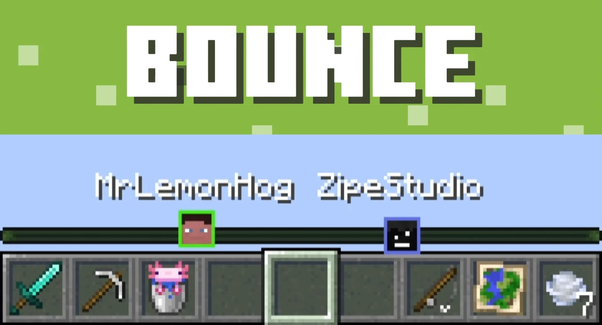
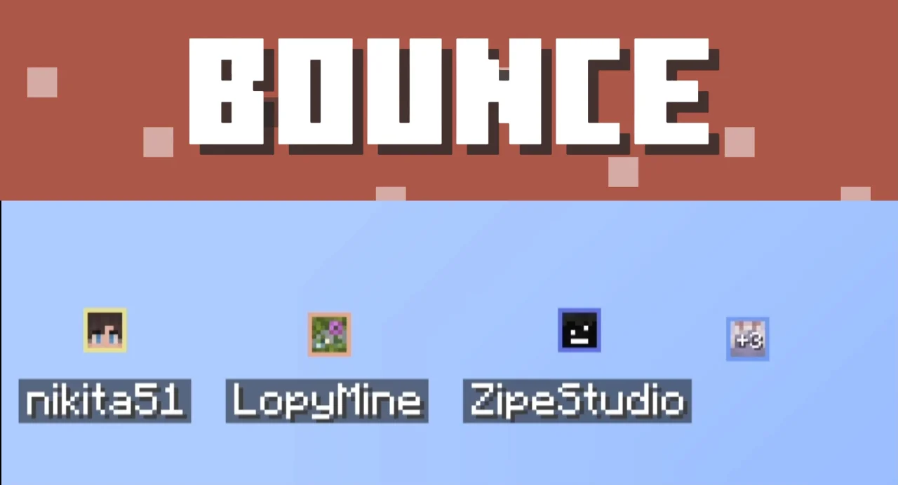
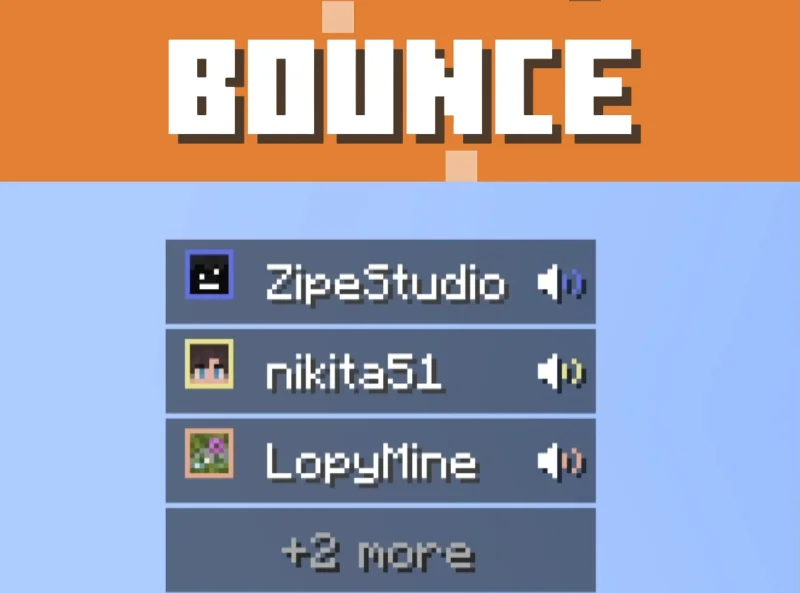
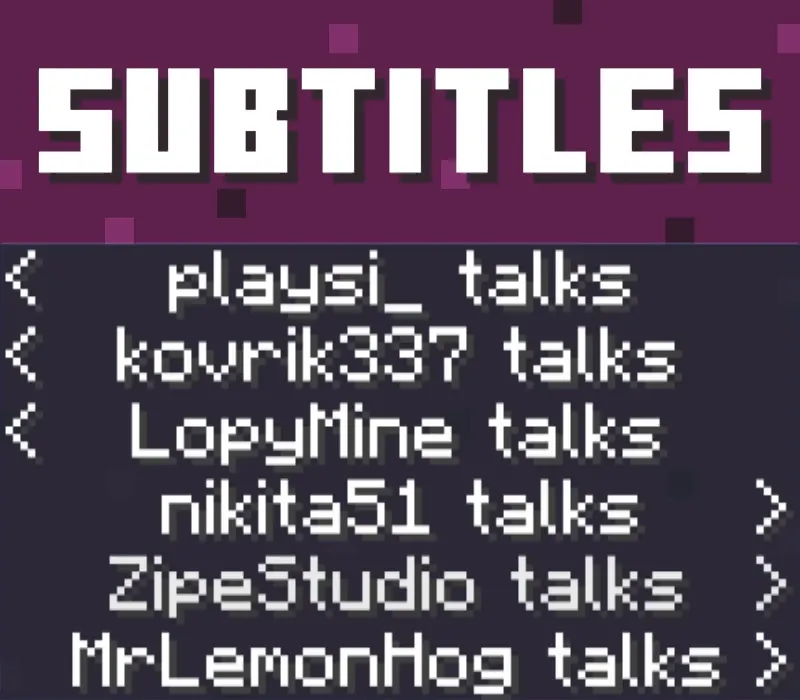
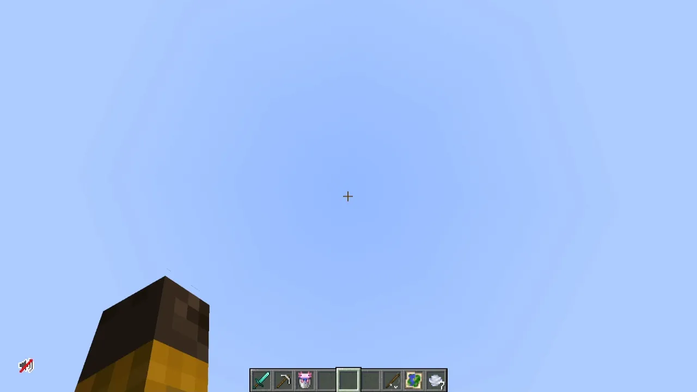

<table style="width: 100%; border-collapse: collapse;">
  <tr>
    <td style="width: 124px; vertical-align: top; text-align: center;">
      

        
      

    </td>
    <td style="vertical-align: top;">
      

        

          
          
          
        

        

          
          
          
        

      

    </td>
  </tr>
</table>

**Talking Huds** — A Client-side addon for [Plasmo Voice](https://modrinth.com/mod/plasmo-voice) & [Simple Voice Chat](https://modrinth.com/mod/simple-voice-chat), that replaces their voice overlay with a new one that has several styles.

## Showcase

### Locator Bar (Pulse, Rings, Bounce)

### Faces in a Row / Column (Pulse, Rings, Bounce)

### List (Pulse, Rings, Bounce)

### Subtitles

Open the settings from Mod Menu (or the mods list), or bind a key for them in Controls. There's no key by default.

- **Drag** the HUD to move it
- **Scroll** over it to resize
- **Arrow keys** nudge it pixel by pixel
- **R-click** the HUD or any option to reset it

### What you can change
- **Display mode**: Faces in a Row, Faces in a Column, List, Subtitles or Locator Bar (1.21.6+)
- **Position** and **head size**, plus how many players fit at once
- **Animation** while someone talks: Pulse, Rings, Bounce or none
- **Fading time**: how long a player stays after they go quiet
- **Names**: show them or not, and how long they can be (16 characters by default)
- **Show yourself** while you're talking
- **Highlight**: a glow and a frame that light up when the player speaks
- **Color**: one for everyone, or **Player Color** to match their dot on the Locator Bar
- **Background** opacity behind List rows and names

### Want to support mod and authors? Just tell everyone about this mod!

Yeah, you got it right. Just by advertising, you will support the mod and the creators well. The more people will know about this mod, the more downloads it will have, more downloads will give good motivation to authors and increase income from the site (literally free donation). **Remember, advertising must not be intrusive and annoiyng!**

### What you can do?
- Make a video review / advertisement
- Share it on social media or Discord
- Tell your friends about this mod
- Add it to your modpack or just download and enjoy the game

> Every mention matters — thank you for helping the community grow 🤍

The license terms for this project are defined in the [LICENSE](https://github.com/ZipeStudio/talking-huds/blob/master/LICENSE.md) file in this repository. That file always takes precedence over any license shown anywhere else.

[**See the original mod repository**](https://github.com/ZipeStudio/talking-huds)